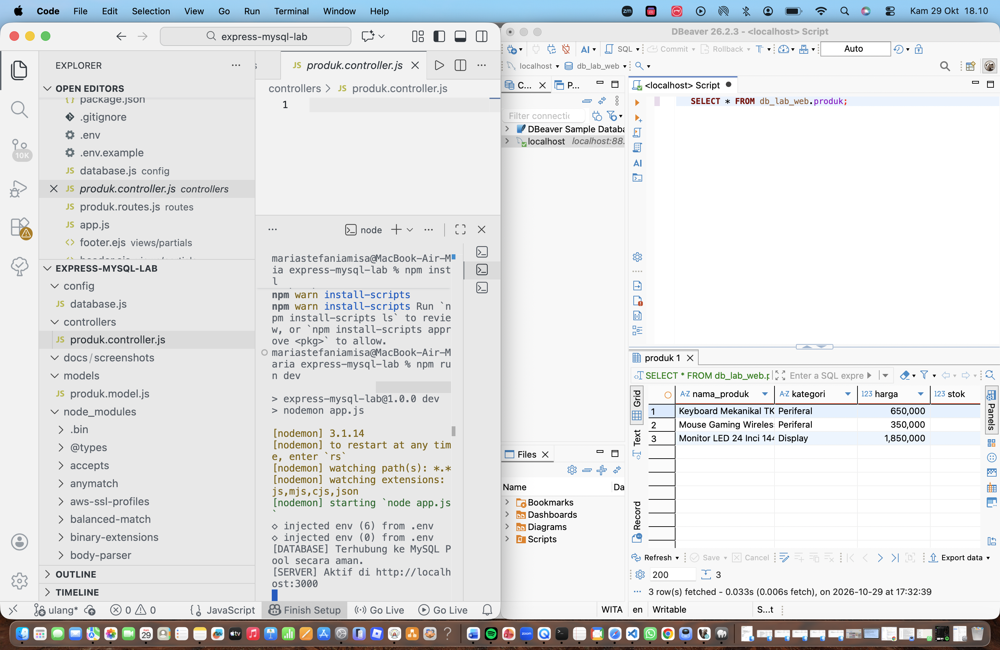
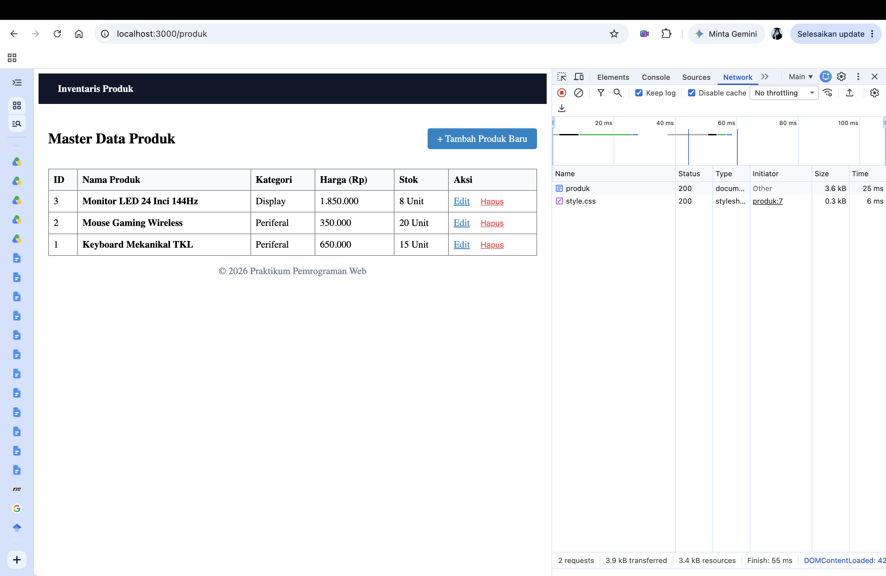
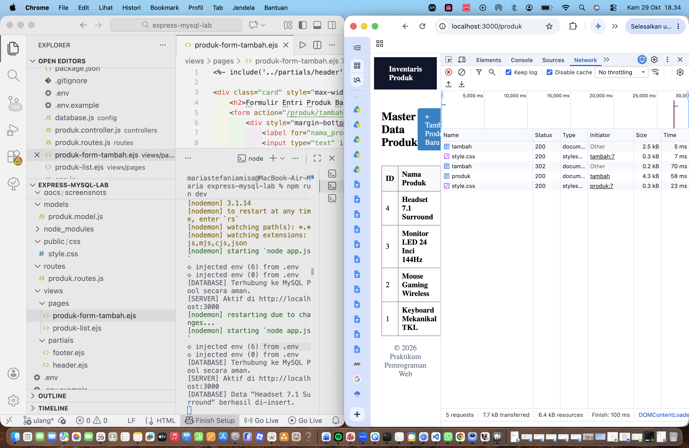
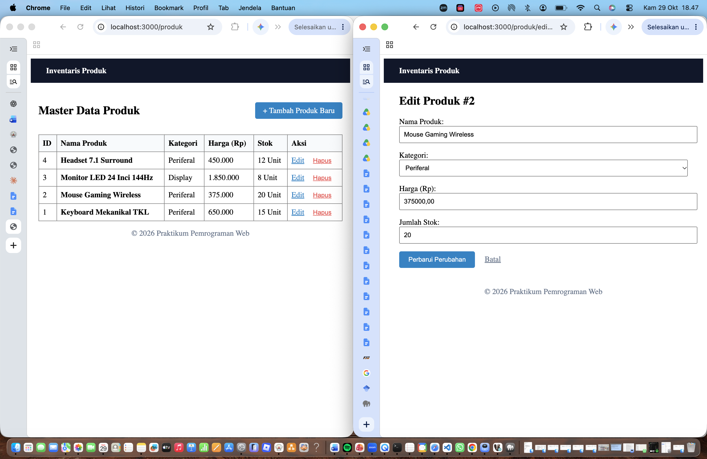
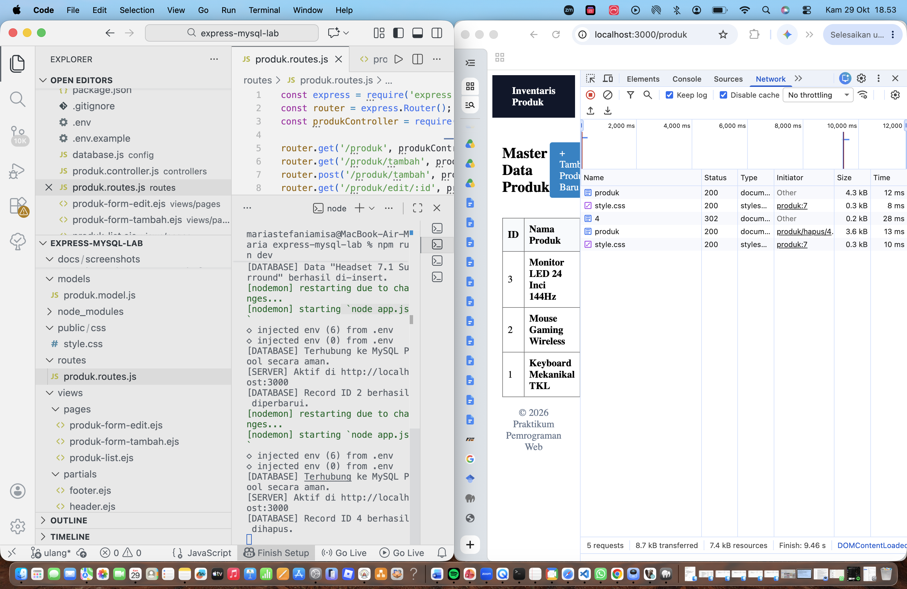
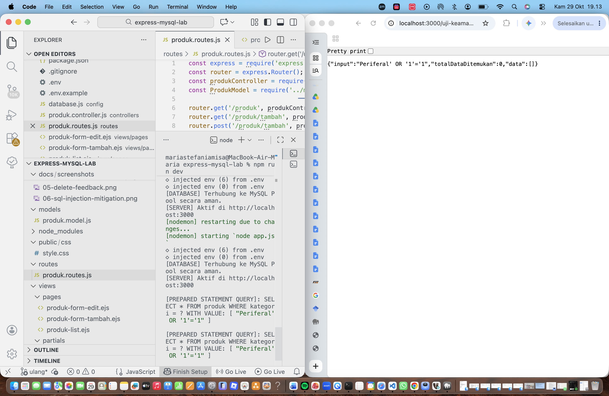
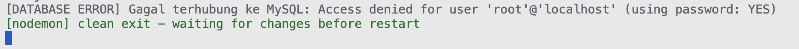
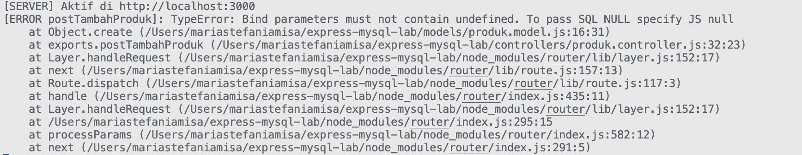
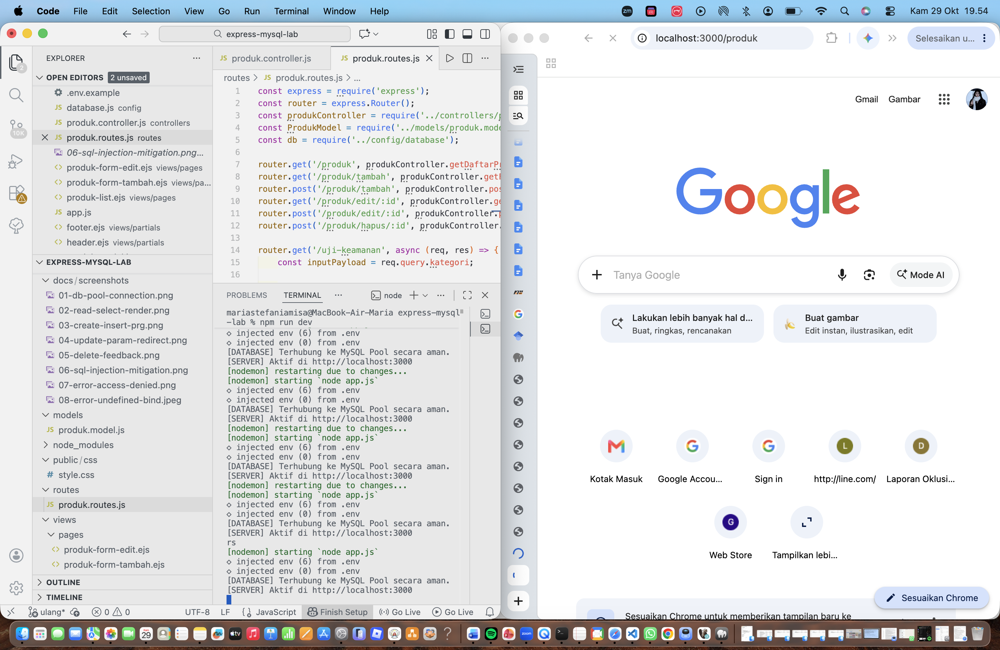

# Modul Praktikum 3: Persistensi MySQL, Connection Pooling, Prepared Statements, dan CRUD Aman

**Mata Kuliah:** Pemrograman Web (MK11)

**Nama:** Maria Stefania Misa

**NIM:** 42530037

**Studi Kasus:** Master Data Produk (Guided Lab)

---

## 1. Deskripsi

Repositori ini berisi hasil Praktikum Modul 3 Pemrograman Web. Aplikasi yang dibangun adalah CRUD Master Data Produk berbasis **Express.js**, **EJS**, dan **MySQL** dengan:

- Kredensial database yang diisolasi di berkas `.env` (pustaka `dotenv`).
- **Connection pool** berbasis promise (`mysql2/promise`).
- Arsitektur **MVC**: seluruh query SQL berada di folder `models/`.
- Query berparameter (placeholder `?`) pada seluruh operasi CRUD.
- Pola **Post-Redirect-Get (PRG)** pada operasi Create, Update, dan Delete.
- Eksperimen keamanan SQL Injection dan tiga skenario troubleshooting.

## 2. Teknologi

| Komponen | Keterangan |
|---|---|
| Runtime | Node.js |
| Framework | Express.js |
| Template Engine | EJS |
| Database | MySQL |
| Driver | mysql2 (promise) |
| Konfigurasi | dotenv |
| Dev Tool | nodemon |

## 3. Struktur Proyek

```
express-mysql-lab/
├── config/
│   └── database.js          # Connection pool (mysql2/promise)
├── controllers/
│   └── produk.controller.js # Alur data dan validasi
├── models/
│   └── produk.model.js      # Seluruh query SQL (placeholder ?)
├── routes/
│   └── produk.routes.js     # Definisi endpoint
├── views/
│   ├── partials/            # header.ejs, footer.ejs
│   └── pages/               # produk-list, produk-form-tambah, produk-form-edit
├── public/css/style.css
├── docs/screenshots/        # Bukti pengujian
├── app.js
├── .env.example
├── .gitignore
└── package.json
```

## 4. Skema Basis Data

```sql
CREATE DATABASE IF NOT EXISTS db_lab_web;
USE db_lab_web;

CREATE TABLE IF NOT EXISTS produk (
  id INT AUTO_INCREMENT PRIMARY KEY,
  nama_produk VARCHAR(100) NOT NULL,
  kategori VARCHAR(50) NOT NULL,
  harga DECIMAL(10, 2) NOT NULL,
  stok INT NOT NULL,
  created_at TIMESTAMP DEFAULT CURRENT_TIMESTAMP
);

INSERT INTO produk (nama_produk, kategori, harga, stok) VALUES
('Keyboard Mekanikal TKL', 'Periferal', 650000.00, 15),
('Mouse Gaming Wireless', 'Periferal', 350000.00, 20),
('Monitor LED 24 Inci 144Hz', 'Display', 1850000.00, 8);
```

## 5. Cara Menjalankan

1. Instal dependensi:
   ```bash
   npm install
   ```
2. Salin `.env.example` menjadi `.env`, lalu sesuaikan nilainya:
   ```env
   PORT=3000
   DB_HOST=localhost
   DB_USER=root
   DB_PASSWORD=
   DB_NAME=db_lab_web
   DB_PORT=3306
   ```
3. Nyalakan server MySQL, lalu jalankan skrip pada bagian 4.
4. Jalankan aplikasi:
   ```bash
   npm run dev
   ```
5. Buka `http://localhost:3000/produk`.

## 6. Peta Endpoint

| Operasi | Endpoint | Method | Parameter / Payload | Respons |
|---|---|---|---|---|
| Read (All) | `/produk` | GET | - | 200 OK (render tabel) |
| Create (form) | `/produk/tambah` | GET | - | 200 OK (render form) |
| Create | `/produk/tambah` | POST | `req.body` | 302 Redirect ke `/produk` |
| Read (One) | `/produk/edit/:id` | GET | `req.params.id` | 200 OK (form terisi) |
| Update | `/produk/edit/:id` | POST | `req.params.id` dan `req.body` | 302 Redirect ke `/produk` |
| Delete | `/produk/hapus/:id` | POST | `req.params.id` | 302 Redirect ke `/produk` |
| Uji Keamanan | `/uji-keamanan?kategori=...` | GET | query string | 200 OK (JSON) |

---

## 7. Matriks Penelusuran Pengujian (Traceability Matrix)

| ID Uji | Fitur / Operasi | Endpoint | Method | Skenario Pengujian | Hasil yang Diharapkan | Status | Bukti |
|---|---|---|---|---|---|---|---|
| TC-01 | Koneksi Pool | App startup | - | Server dijalankan pertama kali | Terhubung ke MySQL Pool tanpa error | Pass | [01-db-pool-connection.png](docs/screenshots/01-db-pool-connection.png) |
| TC-02 | Read (All) | `/produk` | GET | Akses halaman daftar produk | Seluruh record tabel MySQL tampil di antarmuka EJS | Pass | [02-read-select-render.png](docs/screenshots/02-read-select-render.png) |
| TC-03 | Create | `/produk/tambah` | POST | Submit formulir produk baru | Data tersimpan di DB, DevTools mencatat 302 Redirect ke `/produk` | Pass | [03-create-insert-prg.png](docs/screenshots/03-create-insert-prg.png) |
| TC-04 | Update | `/produk/edit/:id` | POST | Mengubah harga dan stok produk | Nilai kolom pada baris MySQL berubah sesuai input baru | Pass | [04-update-param-redirect.png](docs/screenshots/04-update-param-redirect.png) |
| TC-05 | Delete | `/produk/hapus/:id` | POST | Eksekusi tombol hapus produk | Baris terhapus dari MySQL dan UI ter-refresh | Pass | [05-delete-feedback.png](docs/screenshots/05-delete-feedback.png) |
| TC-06 | Keamanan | `/uji-keamanan` | GET | Input `' OR '1'='1` via URL | Prepared statement memperlakukan input sebagai literal string (tanpa injection) | Pass | [06-sql-injection-mitigation.png](docs/screenshots/06-sql-injection-mitigation.png) |
| TC-07 | Troubleshooting | App startup | - | Password `.env` sengaja dibuat salah | Muncul `ER_ACCESS_DENIED_ERROR` | Pass | [07-error-access-denied.png](docs/screenshots/07-error-access-denied.png) |
| TC-08 | Troubleshooting | `/produk/tambah` | POST | Atribut `name="harga"` diubah menjadi `harga_produk` | Server gagal menyimpan karena nilai `harga` tidak terkirim (`undefined`) | Pass | [08-error-undefined-bind.png](docs/screenshots/08-error-undefined-bind.png) |
| TC-09 | Troubleshooting | `/produk` | GET | `connectionLimit: 1` dan koneksi tidak dilepas | Request menggantung karena pool kehabisan koneksi | Pass | [09-error-pool-exhaustion.png](docs/screenshots/09-error-pool-exhaustion.png) |

---

## 8. Dokumentasi Pengalaman Laboratorium

### Pengalaman 1: Konfigurasi Connection Pool Terisolasi

**Tujuan:** Menyiapkan skema MySQL, mengamankan kredensial lewat `.env`, dan menginisialisasi connection pool.

**Yang dikerjakan:**
- Membuat database `db_lab_web` dan tabel `produk` beserta data awal.
- Menyimpan kredensial di `.env` (tidak di-commit; hanya `.env.example` yang diunggah).
- Membuat pool di `config/database.js` dan mengekspornya dengan `pool.promise()`.
- Menambahkan uji koneksi `SELECT 1 + 1` di `app.js` saat server dihidupkan.

```js
const pool = mysql.createPool({
  host: process.env.DB_HOST,
  user: process.env.DB_USER,
  password: process.env.DB_PASSWORD,
  database: process.env.DB_NAME,
  port: process.env.DB_PORT || 3306,
  waitForConnections: true,
  connectionLimit: 10,
  queueLimit: 0
});
module.exports = pool.promise();
```

**Hasil:** Terminal mencetak `[DATABASE] Terhubung ke MySQL Pool secara aman.` dan `[SERVER] Aktif di http://localhost:3000`.

**Bukti:**



---

### Pengalaman 2: Layer Model dan Operasi READ

**Tujuan:** Memisahkan query `SELECT` ke layer Model dan menampilkannya secara dinamis di tabel EJS.

**Yang dikerjakan:**
- `models/produk.model.js` berisi fungsi `getAll()`.
- `controllers/produk.controller.js` memanggil model lalu me-render `pages/produk-list`.
- `routes/produk.routes.js` mendaftarkan `GET /produk`.
- View `produk-list.ejs` me-render baris tabel dengan `forEach`, dan harga diformat lewat `toLocaleString('id-ID')`.

**Inspeksi DevTools:** Tab Network menunjukkan dokumen `produk` dengan **Status 200 OK**, dan dokumen HTML sudah membawa seluruh isi tabel dari MySQL.

**Bukti:**



---

### Pengalaman 3: Create dengan Prepared Statement dan Pola PRG

**Tujuan:** Menyimpan data dari formulir secara aman dan menerapkan Post-Redirect-Get.

**Yang dikerjakan:**
- Fungsi `create()` di model memakai `INSERT INTO produk (...) VALUES (?, ?, ?, ?)`.
- Controller memvalidasi input di sisi server, memanggil model, lalu `res.redirect('/produk')`.
- Rute `GET /produk/tambah` dan `POST /produk/tambah` didaftarkan.

**Inspeksi DevTools (Preserve log aktif):**
1. `POST /produk/tambah` menghasilkan **302 Found** dengan header `Location: /produk`.
2. Dilanjutkan `GET /produk` dengan **200 OK**.

Pola PRG mencegah pengiriman ganda data formulir saat halaman di-refresh.

**Bukti:**



---

### Pengalaman 4: Rute Dinamis `req.params.id` dan UPDATE

**Tujuan:** Mengambil satu record berdasarkan parameter URL untuk mengisi formulir edit (pre-filled), lalu memperbaruinya.

**Yang dikerjakan:**
- Model: `getById(id)` dengan `WHERE id = ?` dan `update(id, data)` dengan `UPDATE ... WHERE id = ?`.
- Controller: `getFormEdit` membaca `req.params.id` (mengembalikan 404 jika produk tidak ada) dan `postUpdateProduk` yang berakhir dengan redirect.
- View `produk-form-edit.ejs` memakai atribut `value` dan `selected` untuk mengisi data lama.

**Hasil:** URL berubah menjadi format dinamis (contoh `/produk/edit/2`), form menampilkan data lama, dan setelah disimpan tabel menampilkan nilai terbaru. Terminal mencatat `[DATABASE] Record ID ... berhasil diperbarui.`

**Bukti:**



---

### Pengalaman 5: Operasi DELETE dan Validasi Integritas

**Tujuan:** Menghapus record berdasarkan `id` dan memastikan penghapusan bersifat persisten.

**Yang dikerjakan:**
- Model: `delete(id)` dengan `DELETE FROM produk WHERE id = ?`.
- Controller memeriksa `result.affectedRows` untuk mencatat log yang sesuai, lalu redirect ke `/produk`.
- Tombol Hapus berada di dalam `<form method="POST">` dengan dialog `confirm()` di sisi klien.

**Hasil:** DevTools mencatat `POST /produk/hapus/X` dengan status **302 Found**. Query `SELECT * FROM produk;` di klien MySQL menunjukkan record tersebut sudah hilang. Terminal mencatat `[DATABASE] Record ID X berhasil dihapus.`

**Bukti:**



---

### Pengalaman 6: Eksperimen Keamanan SQL Injection

**Tujuan:** Membuktikan kelemahan query berbasis konkatenasi string dan ketahanan query berparameter.

**Payload uji:**

```
http://localhost:3000/uji-keamanan?kategori=Periferal' OR '1'='1
```

| Skenario | Query yang terbentuk | Hasil |
|---|---|---|
| A. Rentan (konkatenasi) | `SELECT * FROM produk WHERE kategori = 'Periferal' OR '1'='1'` | Klausa `'1'='1'` selalu benar sehingga **seluruh isi tabel bocor** |
| B. Aman (placeholder `?`) | `SELECT * FROM produk WHERE kategori = ?` dengan nilai `Periferal' OR '1'='1` | Seluruh string diperlakukan sebagai **nilai literal**, hasil 0 data |

**Catatan teknis:** `db.query()` pada mysql2 melakukan *escaping* parameter di sisi klien, sedangkan `db.execute()` memakai prepared statement sungguhan di sisi server. Keduanya memisahkan nilai input dari struktur SQL sehingga payload tidak dieksekusi sebagai kode.

**Bukti:**



---

## 9. Laboratorium Investigasi Masalah (Troubleshooting)

### Kasus 1: `ER_ACCESS_DENIED_ERROR` pada Variabel Lingkungan

- **Pemicu:** Nilai `DB_PASSWORD` di `.env` diubah menjadi sandi yang salah (`salah_password_123`), lalu server dijalankan ulang.
- **Gejala:** Terminal menampilkan `Access denied for user 'root'@'localhost'`.
- **Analisis:** Koneksi pool ditolak pada tahap autentikasi, sebelum query apa pun dieksekusi. Karena itu server tidak sampai memanggil `app.listen()`.
- **Solusi:** Kembalikan `DB_PASSWORD` ke nilai yang benar, simpan, lalu jalankan ulang server.



---

### Kasus 2: Parameter `undefined` pada Insert

- **Pemicu:** Pada `produk-form-tambah.ejs`, atribut `name="harga"` diubah menjadi `name="harga_produk"`, lalu formulir dikirim.
- **Gejala:** Terminal menampilkan galat saat menyimpan data (pada modul: `Bind parameters must not contain undefined`).
- **Analisis:** Controller membaca `req.body.harga`, padahal nama input HTML sudah berbeda, sehingga nilainya `undefined`. Driver menolak atau gagal menyimpan karena parameter tidak valid. Pesan galat yang tampil bergantung pada metode yang dipakai: `execute()` menolak `undefined` secara langsung, sedangkan `query()` mengubahnya menjadi `NULL` yang kemudian ditolak MySQL pada kolom `NOT NULL`. Pada kedua kasus, akar masalahnya sama: nama field form tidak cocok dengan variabel di controller.
- **Solusi:** Samakan atribut `name` di form dengan variabel yang diekstrak controller (`harga`).



---

### Kasus 3: Connection Pool Exhaustion / Timeout

- **Pemicu:** Pada `config/database.js`, `connectionLimit` diubah menjadi `1`, dan koneksi diambil tanpa dilepas (`release`) atau query dipanggil paralel secara masif.
- **Gejala:** Request menggantung (loading tanpa akhir) karena tidak ada koneksi bebas di dalam pool.
- **Analisis:** Dengan batas satu koneksi yang tidak pernah dikembalikan, setiap request berikutnya mengantre menunggu koneksi idle yang tidak akan pernah tersedia (kebocoran koneksi / *connection leak*).
- **Solusi:** Kembalikan `connectionLimit` ke nilai wajar (`10`) dan gunakan antarmuka `pool.promise()` sehingga koneksi dilepaskan otomatis setelah query selesai. Jika koneksi diambil manual, selalu panggil `connection.release()` (misalnya di blok `finally`).



---

## 10. Catatan Keamanan

- Seluruh query CRUD memakai placeholder `?`; tidak ada konkatenasi string pada query produksi. Fungsi `getByKategoriInsecure` hanya dipakai sementara untuk eksperimen di Pengalaman 6.
- Kredensial database disimpan di `.env` yang dikecualikan lewat `.gitignore`. Repositori hanya memuat `.env.example`.
- Validasi sederhana dilakukan di sisi server sebelum data masuk ke layer Model.

## 11. Kesimpulan

Praktikum ini membuktikan bahwa:

1. Connection pool memungkinkan banyak request ditangani bersamaan tanpa membuka koneksi baru setiap kali.
2. Memisahkan query SQL ke layer Model membuat kode lebih modular dan mudah dirawat.
3. Pola Post-Redirect-Get menjaga integritas data pada operasi Create, Update, dan Delete.
4. Query berparameter efektif menggagalkan serangan SQL Injection karena input dan struktur SQL dipisahkan.
5. Galat umum (kredensial salah, nama field tidak cocok, pool kehabisan koneksi) dapat didiagnosis dari pesan terminal dan diperbaiki secara sistematis.